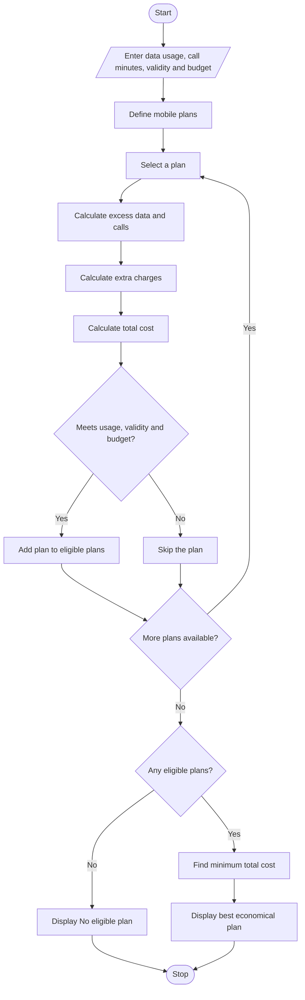

## 1. Problem Statement

Develop a Python program to evaluate multiple mobile recharge plans based on the user's data usage, call usage, validity period, and budget.

The program should:

- Accept user requirements such as data usage, call minutes, validity, and budget.
- Compare multiple mobile plans.
- Calculate extra charges when usage exceeds the plan limits.
- Check whether each plan satisfies the user's requirements and budget.
- Identify and display the most economical eligible mobile plan.

## 2. Algorithm

1. Start the program.
2. Read the user's required data, call minutes, validity, and budget.
3. Define multiple mobile plans with their prices and limits.
4. Calculate excess data and call usage for each plan.
5. Calculate additional charges.
6. Calculate the total cost of each plan.
7. Check whether the plan satisfies the usage, validity, and budget requirements.
8. Select the eligible plan with the lowest total cost.
9. Display all plan details and the best economical plan.
10. If no plan is eligible, display a suitable message.
11. Stop.

## 3. Flowchart 



## 4. Sample Input

```
Enter required data (GB): 5
Enter required call minutes: 600
Enter required validity (days): 28
Enter your budget: 500
```

## 5. Sample Output

```
--- Mobile Plan Comparison ---

Plan: Basic
Base Price: 199
Extra Charges: 320
Total Cost: 519

Plan: Smart
Base Price: 299
Extra Charges: 0
Total Cost: 299

Plan: Premium
Base Price: 399
Extra Charges: 0
Total Cost: 399

Plan: Unlimited
Base Price: 599
Extra Charges: 0
Total Cost: 599

--- Best Economical Plan ---
Plan Name: Smart
Total Cost: Rs. 299

Optimization Completed.
```


