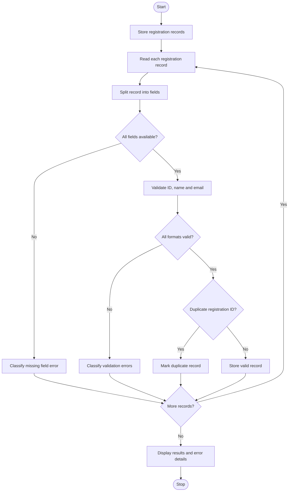

## 1. Problem Statement

Write a Python program to analyze registration records stored as structured strings. The program should split each registration record into individual fields, validate field lengths and formats, extract the required components, identify duplicate registration IDs, and classify errors such as invalid ID, invalid name, invalid email, and missing fields. Finally, display valid records, duplicate records, and error classifications.

## 2. Algorithm

1. Start the program.
2. Store registration records in a list of strings.
3. Create empty lists to store valid records, duplicate IDs, and errors.
4. Split each registration string using the separator `|`.
5. Check whether all required fields are available.
6. Validate the registration ID format and length.
7. Validate the name length.
8. Validate the email format.
9. Check whether the registration ID already exists.
10. Classify errors for invalid records.
11. Store records that pass all validations.
12. Display valid records, duplicates, and error details.
13. Stop the program.

## 3. Flowchart 


## 4. Sample Input

```
REG101|Harshitha|harshi@gmail.com
REG102|Anu|anu123@gmail.com
REG103|Ravi|ravi@gmail.com
REG101|Kiran|kiran@gmail.com
R1|Sai|sai@gmail.com
REG104|Priya|priyaemail.com
REG105|Teja
REG106|A|teja@gmail.com
```

## 5. Sample Output

```
VALID REGISTRATION RECORDS:
ID: REG101 | Name: Harshitha | Email: harshi@gmail.com
ID: REG102 | Name: Anu | Email: anu123@gmail.com
ID: REG103 | Name: Ravi | Email: ravi@gmail.com

DUPLICATE IDs:
REG101

ERROR CLASSIFICATION:
REG101|Kiran|kiran@gmail.com : Duplicate registration ID
R1|Sai|sai@gmail.com : Invalid registration ID
REG104|Priya|priyaemail.com : Invalid email format
REG105|Teja : Missing or extra fields
REG106|A|teja@gmail.com : Invalid name length

TOTAL RECORDS: 8
VALID RECORDS: 3
INVALID RECORDS: 5
DUPLICATES: 1
```

