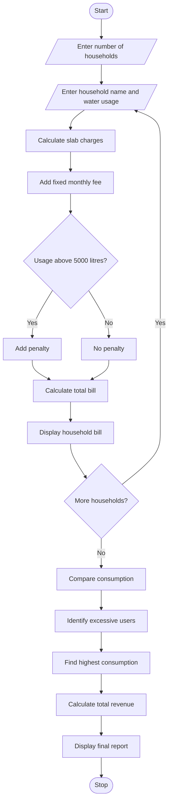

## 1. Problem Statement

Develop a Python program to calculate water bills for multiple households based on their monthly water consumption.

The program should:

- Accept household names and water consumption in litres.
- Calculate water charges using progressive consumption slabs.
- Apply fixed monthly charges.
- Add penalties for excessive water usage.
- Calculate the total bill for each household.
- Compare water consumption among households.
- Identify households with excessive water usage.
- Display the highest water-consuming household and the total revenue collected.

## 2. Algorithm

1. Start the program.
2. Enter the number of households.
3. Read the household name and monthly water consumption.
4. Calculate water charges using progressive tariff slabs.
5. Add the fixed monthly fee.
6. Check whether consumption exceeds the allowed limit.
7. Apply a penalty for excessive usage.
8. Calculate the final water bill.
9. Display each household's bill.
10. Compare the consumption of all households.
11. Identify excessive water users.
12. Display the highest consumption and total revenue.
13. Stop the program.

## 3. Flowchart 



## 4. Sample Input

```
Enter number of households: 3

Household 1
Enter household name: Ravi
Enter water usage (litres): 2000

Household 2
Enter household name: Sita
Enter water usage (litres): 4000

Household 3
Enter household name: Kumar
Enter water usage (litres): 6000
```

## 5. Sample Output

```
Water Charge: Rs. 60.0
Fixed Fee: Rs. 50
Penalty: Rs. 0
Total Bill: Rs. 110.0

Water Charge: Rs. 180.0
Fixed Fee: Rs. 50
Penalty: Rs. 0
Total Bill: Rs. 230.0

Water Charge: Rs. 320.0
Fixed Fee: Rs. 50
Penalty: Rs. 100
Total Bill: Rs. 470.0

--- HOUSEHOLD COMPARISON ---

Ravi - Usage: 2000 litres
Status: Normal Usage

Sita - Usage: 4000 litres
Status: Normal Usage

Kumar - Usage: 6000 litres
Status: Excessive Usage

Highest Consumption:
Household: Kumar
Usage: 6000 litres

Total Revenue: Rs. 810.0
Analysis Completed.
```

