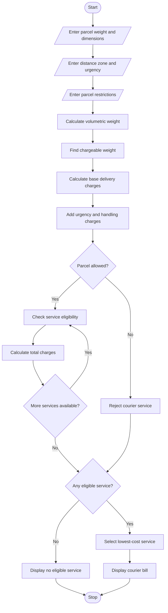

## 1. Problem Statement

Develop a Python program to calculate courier delivery charges based on parcel weight, dimensions, delivery distance zones, urgency, and declared restrictions.

The program should:

- Accept parcel weight, length, width, and height.
- Calculate the volumetric weight of the parcel.
- Consider the delivery distance zone.
- Calculate charges based on actual or volumetric weight, whichever is higher.
- Apply additional charges for urgent delivery.
- Check declared restrictions such as fragile and prohibited items.
- Compare different courier service options.
- Select the most economical eligible courier service.
- Display the final delivery charges.

## 2. Algorithm

1. Start the program.
2. Enter parcel weight and dimensions.
3. Enter the delivery distance zone.
4. Select the delivery urgency.
5. Enter parcel restriction details.
6. Calculate volumetric weight using length × width × height / 5000.
7. Compare actual weight and volumetric weight.
8. Select the higher weight.
9. Calculate delivery charges based on distance zone.
10. Add urgent delivery and fragile handling charges.
11. Check courier service eligibility.
12. Compare the total charges of eligible services.
13. Select the lowest-cost eligible service.
14. Display the courier charges and selected service.
15. Stop the program.

## 3. Flowchart 



## 4. Sample Input

```
COURIER CHARGE OPTIMIZATION

Enter parcel weight (kg): 5
Enter length (cm): 20
Enter width (cm): 15
Enter height (cm): 10
Enter distance zone (Local/National/International): national
Enter urgency (Normal/Express): normal
Is parcel fragile? (yes/no): no
Is item prohibited? (yes/no): no
Enter your budget: 600
```

## 5. Sample Output

```
--- COURIER SERVICE COMPARISON ---

Service: Standard
Chargeable Weight: 5.0 kg
Base Charge: Rs. 400.0
Service Charge: Rs. 0
Urgency Charge: Rs. 0
Fragile Charge: Rs. 0
Total Charge: Rs. 400.0

Service: Premium
Chargeable Weight: 5.0 kg
Base Charge: Rs. 400.0
Service Charge: Rs. 50
Urgency Charge: Rs. 0
Fragile Charge: Rs. 0
Total Charge: Rs. 450.0

Service: Express
Chargeable Weight: 5.0 kg
Base Charge: Rs. 400.0
Service Charge: Rs. 100
Urgency Charge: Rs. 0
Fragile Charge: Rs. 0
Total Charge: Rs. 500.0

--- BEST COURIER SERVICE ---

Service Name: Standard
Final Charge: Rs. 400.0

Optimization Completed.
```

