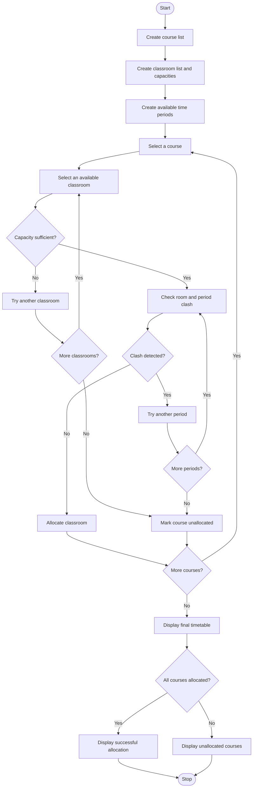

## 1. Problem Statement

Develop a Python program to allocate courses to classrooms and time periods using lists and tuples.

The program should:

- Store course names, student strengths, classroom names, and room capacities.
- Represent courses, rooms, and periods using lists and tuples.
- Allocate classrooms based on student strength.
- Validate classroom capacity before allocation.
- Detect timetable clashes when two courses are assigned to the same room and period.
- Check whether all courses can be accommodated.
- Display the final classroom timetable.
- Report unallocated courses and scheduling conflicts.

## 2. Algorithm

1. Start the program.
2. Create a list of courses with student strengths.
3. Create a list of classrooms with their capacities.
4. Create a tuple of available time periods.
5. Read the required course details.
6. Select a classroom for each course.
7. Check whether the classroom capacity is sufficient.
8. Check whether the classroom and time period are already occupied.
9. If both conditions are satisfied, allocate the classroom.
10. Otherwise, search for another available classroom or period.
11. Repeat until all courses are processed.
12. Display the final timetable.
13. Display unallocated courses and clash details.
14. Check whether all courses are accommodated.
15. Stop the program.

## 3. Flowchart 


## 4. Sample Input

This program uses predefined course, classroom, and period details, so no keyboard input is required.

Course Details:

| Course          | Students |
| --------------- | -------- |
| Python          | 40       |
| Mathematics     | 60       |
| English         | 30       |
| Web Development | 50       |
| Physics         | 80       |

Classroom Details:

| Room   | Capacity |
| ------ | -------- |
| Room A | 40       |
| Room B | 60       |
| Room C | 100      |

Available Periods: 9AM, 10AM, 11AM

## 5. Sample Output

```
SMART CLASSROOM TIMETABLE

--- FINAL TIMETABLE ---

Course: Python
Room: Room A
Period: 9AM
Students: 40
-------------------

Course: Mathematics
Room: Room B
Period: 9AM
Students: 60
-------------------

Course: English
Room: Room A
Period: 10AM
Students: 30
-------------------

Course: Web Development
Room: Room B
Period: 10AM
Students: 50
-------------------

Course: Physics
Room: Room C
Period: 9AM
Students: 80
-------------------

--- ALLOCATION REPORT ---

Allocated Courses: 5
Unallocated Courses: 0
All courses allocated successfully!

Timetable Allocation Completed.
```

