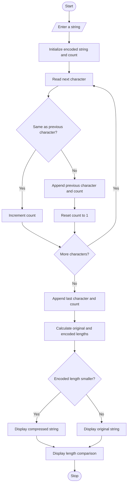

## 1. Problem Statement

Develop a Python program to compress a given string by grouping consecutive repeated characters using Run-Length Encoding (RLE).

The program should:

- Accept a string from the user.
- Identify consecutive repeated characters.
- Count the number of occurrences of each character.
- Encode repeated characters with their character and count.
- Compare the original string length with the encoded string length.
- Determine whether compression is beneficial.
- If the encoded string is longer than the original, display the original string instead.
- Display the final compressed or original string.

## 2. Algorithm

1. Start the program.
2. Read a string from the user.
3. Initialize an empty encoded string.
4. Set the count of the first character to 1.
5. Traverse the string character by character.
6. If the current character matches the previous character, increment the count.
7. Otherwise, append the previous character and its count to the encoded string.
8. Reset the count to 1.
9. Append the last character and its count.
10. Calculate the original and encoded string lengths.
11. Compare both lengths.
12. If the encoded string is shorter, display the compressed string.
13. Otherwise, display the original string.
14. Stop the program.

## 3. Flowchart

## 4. Sample Input

```
Enter a string: aaabbbbccdddddd
```

## 5. Sample Output

```
--- COMPRESSION RESULT ---

Original String: aaabbbbccdddddd
Encoded String: a3b4c2d6
Original Length: 15
Encoded Length: 8

Compression is beneficial!
Final String: a3b4c2d6

Compression Completed.
```

## 6. Another Sample Input (Compression Not Beneficial)

```
Enter a string: abcdef
```

Sample Output:

```
--- COMPRESSION RESULT ---

Original String: abcdef
Encoded String: a1b1c1d1e1f1
Original Length: 6
Encoded Length: 12

Compression is not beneficial!
Final String: abcdef

Compression Completed.
```
