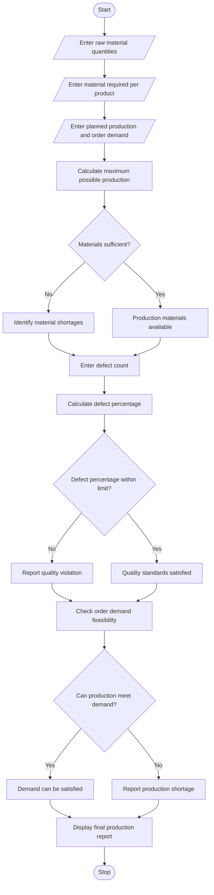

## 1. Problem Statement

Develop a Python program to analyse manufacturing production using raw materials, production quantities, defect counts, and customer order demand.

The program should:

- Accept available raw material quantities.
- Accept required material per product.
- Read the planned production quantity and customer order demand.
- Calculate the maximum possible production quantity.
- Check whether available materials are sufficient.
- Identify raw material shortages.
- Calculate defective products and defect percentage.
- Check quality violations based on the allowed defect limit.
- Determine whether production can satisfy customer demand.
- Display a final production feasibility report.

## 2. Algorithm

1. Start the program.
2. Enter the available raw material quantities.
3. Enter the material required for each product.
4. Enter planned production quantity and customer order demand.
5. Calculate the maximum production possible using available materials.
6. Compare maximum production with planned production.
7. Identify raw material shortages.
8. Enter the number of defective products.
9. Calculate the defect percentage.
10. Compare defect percentage with the allowed defect limit.
11. Check whether production satisfies customer demand.
12. Display material shortages and quality violations.
13. Display the final production feasibility report.
14. Stop the program.

## 3. Flowchart 



## 4. Sample Input

```
INTEGRATED MANUFACTURING PRODUCTION PLANNER

Enter planned production quantity: 100
Enter customer order demand: 90
Enter defective products: 3
```

## 5. Sample Output

```
--- MATERIAL ANALYSIS ---

Steel Available: 500
Required: 200
Status: Sufficient

Plastic Available: 300
Required: 100
Status: Sufficient

Rubber Available: 200
Required: 100
Status: Sufficient

Maximum Production: 200

Material Status: Feasible

--- QUALITY ANALYSIS ---

Defective Products: 3
Defect Percentage: 3.0 %
Quality Status: Accepted

--- ORDER ANALYSIS ---

Customer Demand: 90
Good Products: 97
Order Status: Demand Satisfied

--- FINAL REPORT ---

Production Status: SUCCESS

Production Analysis Completed.
```

- Customer Demand: 90 units
- Production Status: SUCCESS
