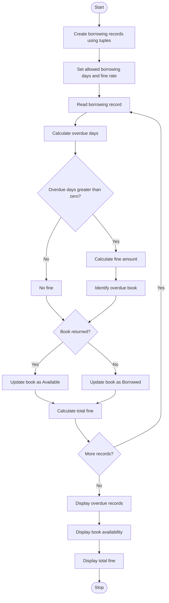

## 1. Problem Statement

Develop a Python program to manage library borrowing records using tuples containing book identifiers, borrowing periods, and return delays.

The program should:

- Store book IDs, borrower names, borrowing days, and return delays using tuples.
- Calculate the fine for overdue books.
- Identify books that are returned late.
- Check whether books are available or borrowed.
- Calculate the total fine collected.
- Reconcile book availability after returns.
- Display overdue records and a final library report.

## 2. Algorithm

1. Start the program.
2. Create tuples containing book IDs, borrower names, borrowing periods, and return delays.
3. Define the maximum borrowing period.
4. Define the fine amount per overdue day.
5. Read and process each borrowing record.
6. Compare the borrowing period with the allowed period.
7. Calculate overdue days.
8. Calculate the fine amount for each overdue book.
9. Identify overdue books.
10. Update book availability based on return status.
11. Calculate the total fine amount.
12. Display borrowing records and overdue details.
13. Display available and borrowed books.
14. Stop the program.

## 3. Flowchart 


## 4. Sample Input

This program uses predefined borrowing records, so no keyboard input is required.

| Book ID | Borrower | Borrowing Days | Return Status |
| ------- | -------- | -------------- | ------------- |
| B101    | Ravi     | 10             | Returned      |
| B102    | Sita     | 18             | Returned      |
| B103    | Kumar    | 20             | Not Returned  |
| B104    | Priya    | 7              | Returned      |
| B105    | Arun     | 15             | Returned      |

Conditions:

- Maximum borrowing period: 14 days
- Fine per overdue day: ₹5

## 5. Sample Output

```
LIBRARY BORROWING REPORT

Book ID: B101
Borrower: Ravi
Borrowing Days: 10
Overdue Days: 0
Fine: Rs. 0
Status: Normal

Book ID: B102
Borrower: Sita
Borrowing Days: 18
Overdue Days: 4
Fine: Rs. 20
Status: Overdue

Book ID: B103
Borrower: Kumar
Borrowing Days: 20
Overdue Days: 6
Fine: Rs. 30
Status: Overdue

Book ID: B104
Borrower: Priya
Borrowing Days: 7
Overdue Days: 0
Fine: Rs. 0
Status: Normal

Book ID: B105
Borrower: Arun
Borrowing Days: 15
Overdue Days: 1
Fine: Rs. 5
Status: Overdue

--- OVERDUE BOOKS ---
['B102', 'B103', 'B105']

--- BOOK AVAILABILITY ---
Available Books: ['B101', 'B102', 'B104', 'B105']
Borrowed Books: ['B103']

--- FINAL RECONCILIATION ---
Total Books: 5
Available Count: 4
Borrowed Count: 1
Total Fine: Rs. 55

Library Analysis Completed.
```

