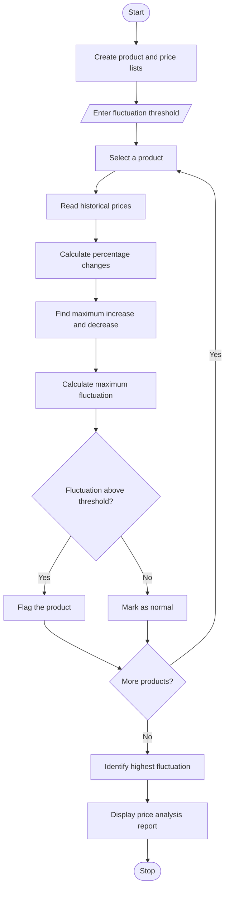

## 1. Problem Statement

Develop a Python program to analyse historical product prices stored in lists and identify price fluctuations.

The program should:

- Store multiple product names and their historical prices using lists.
- Calculate percentage changes between consecutive prices.
- Identify the maximum price increase and decrease.
- Compare price fluctuations with a user-provided threshold.
- Flag products whose price changes exceed the given threshold.
- Identify products with the highest price fluctuation.
- Display a detailed price analysis report.

## 2. Algorithm

1. Start the program.
2. Create lists containing product names and historical prices.
3. Read the fluctuation threshold from the user.
4. Select each product from the product list.
5. Read its historical prices.
6. Calculate percentage changes between consecutive prices.
7. Identify maximum price increase and decrease.
8. Calculate the maximum percentage fluctuation.
9. Compare the fluctuation with the given threshold.
10. If the fluctuation exceeds the threshold, flag the product.
11. Repeat the process for all products.
12. Identify the product with the highest fluctuation.
13. Display the final price analysis report.
14. Stop the program.

## 3. Flowchart 


## 4. Sample Input

```
Enter fluctuation threshold (%): 15
```

Predefined product price details:

| Product    | Historical Prices (₹)      |
| ---------- | -------------------------- |
| Laptop     | 40000, 42000, 45000, 48000 |
| Mobile     | 15000, 14000, 16000, 18000 |
| Tablet     | 20000, 21000, 20500, 22000 |
| Headphones | 2000, 2500, 3000, 2800     |

## 5. Sample Output

```
--- PRODUCT PRICE ANALYSIS ---

Product: Laptop
Historical Prices: [40000, 42000, 45000, 48000]
Percentage Changes: [5.0, 7.14, 6.67]
Maximum Increase: 7.14 %
Maximum Decrease: 5.0 %
Maximum Fluctuation: 7.14 %
Status: Normal

Product: Mobile
Historical Prices: [15000, 14000, 16000, 18000]
Percentage Changes: [-6.67, 14.29, 12.5]
Maximum Increase: 14.29 %
Maximum Decrease: -6.67 %
Maximum Fluctuation: 14.29 %
Status: Normal

Product: Tablet
Historical Prices: [20000, 21000, 20500, 22000]
Percentage Changes: [5.0, -2.38, 7.32]
Maximum Increase: 7.32 %
Maximum Decrease: 7.32 %
Maximum Fluctuation: 7.32 %
Status: Normal

Product: Headphones
Historical Prices: [2000, 2500, 3000, 2800]
Percentage Changes: [25.0, 20.0, -6.67]
Maximum Increase: 25.0 %
Maximum Decrease: -6.67 %
Maximum Fluctuation: 25.0 %
Status: High Fluctuation

--- FINAL REPORT ---
Flagged Products: ['Headphones']
Highest Fluctuation Product: Headphones
Highest Fluctuation: 25.0 %

Price Analysis Completed.
```
